# 图图零食店

一款基于 AI 智能体的移动端电商零食店应用，为用户提供智能化的零食购物体验。

## ✨ 项目简介

图图零食店是一款基于 **AI 智能体「构想」** 的移动端电商零食店应用。智能体「构想」通过自然交互、个性化决策和全流程协同能力，为用户提供智能化的零食店下单服务，让零食店购物体验更高效、更个性化、更愉悦。

## 🛠 技术栈

### 前端

- **框架**: [uni-app](https://uniapp.dcloud.net.cn/)（Vue 3 + TypeScript）
- **状态管理**: [Pinia](https://pinia.vuejs.org/zh/)
- **组件库**: [uni-ui](https://uniapp.dcloud.net.cn/component/uniui/uni-ui.html)
- **构建工具**: Vite

### 后端

- **语言**: Java
- **数据库**: MySQL
- **ORM 框架**: MyBatis
- **AI 大模型**: 百度千帆 Qianfan ERNIE-3.5-8K（智能体「构想」核心引擎）

## 🚀 核心功能

### 🤖 AI 智能体「构想」

- **智能对话**: 基于百度千帆 ERNIE-3.5-8K 大模型，用户可通过自然语言与智能体交互
- **个性化推荐**: 智能体根据用户偏好和历史行为，为用户推荐合适的零食商品
- **智能购物助手**: 帮助用户查询商品、加入购物车、确认订单等全流程服务

### 🛒 商品浏览与购物

- **商品列表**: 浏览零食店的各类商品，支持分类浏览
- **商品详情**: 查看商品图片、价格、库存等详细信息
- **购物车**: 添加商品到购物车，支持数量增减、删除、清空
- **商品搜索**: 快速搜索所需商品
- **个性化推荐**: AI 智能推荐符合用户口味的零食商品

### 📋 订单管理

- **下单结算**: 确认商品信息、提交订单
- **订单列表**: 查看全部订单，支持按状态筛选（全部/待确认/配送中/已完成/已取消）
- **订单详情**: 查看订单完整信息，包括商品、金额、配送状态
- **配送进度**: 可视化展示订单从"商家接单"到"已送达"的完整流程
- **催单功能**: 一键催单，实时提示
- **退款申请**: 支持订单退款申请
- **再来一单**: 快速复购历史订单

### 👤 用户中心

- **登录注册**: 支持账号密码登录和注册新账号
- **个人信息**: 展示用户头像、昵称等基本信息
- **我的收藏**: 展示收藏的商品
- **订单统计**: 显示总订单数、收藏数、积分
- **地址管理**: 管理收货地址
- **退出登录**: 安全退出账号

### ⚙️ 系统设置

- **通用设置**: 老人模式、消息通知、自动更新等开关
- **账户与安全**: 密码、验证码等安全设置
- **法律条款**: 隐私政策、用户协议
- **意见反馈**: 向开发者提交反馈和建议
- **关于我们**: 查看版本信息和公司介绍

## 📁 项目结构

```
├── tutu-snack-shop-git                 # 源代码目录
│   ├── tutu-snack-shop-backend         # 后端文件夹
│   ├── tutu-snack-shop-fronted         # 前端文件夹
│   ├── README.md                       # 项目简介
```

## 📱 页面图片

### 首页

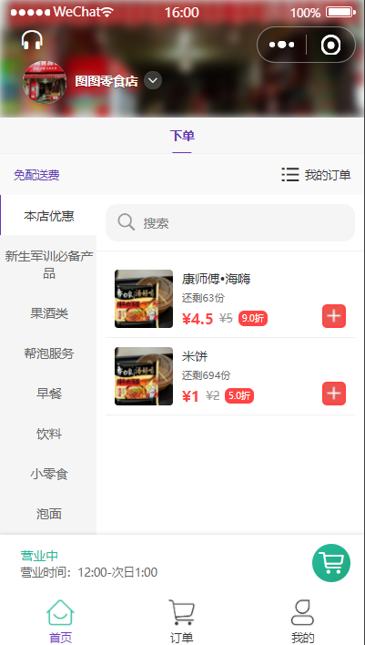

**添加购物车**

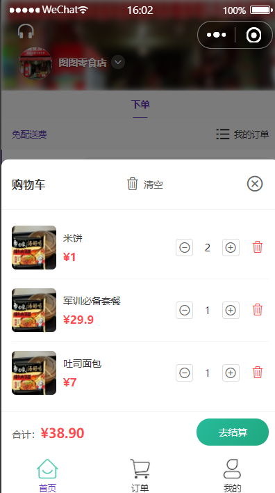

**结算**

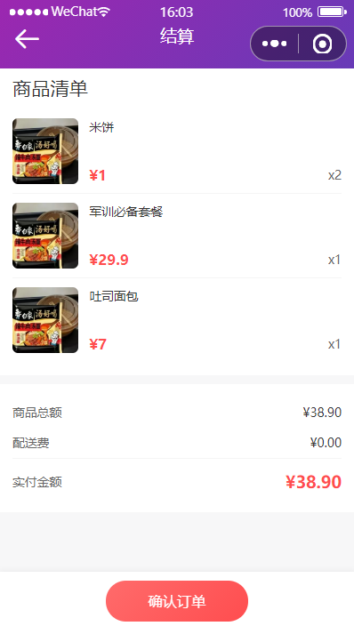

**生成对应订单**

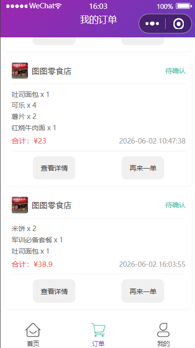

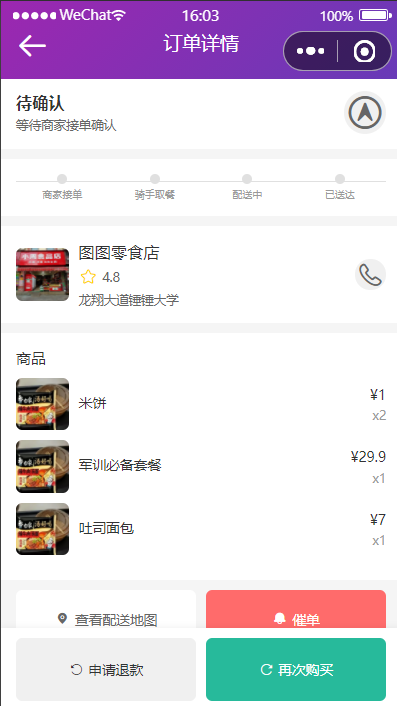

**再次购买**

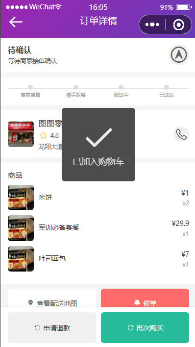

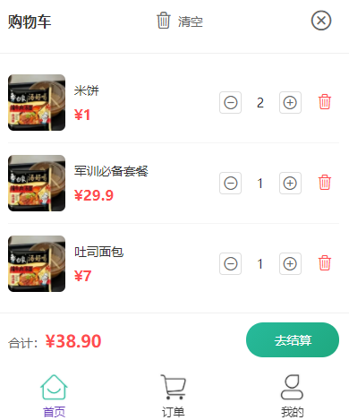

**退款**

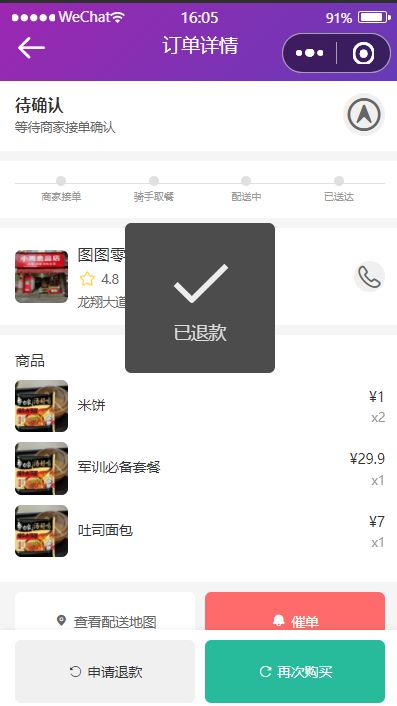

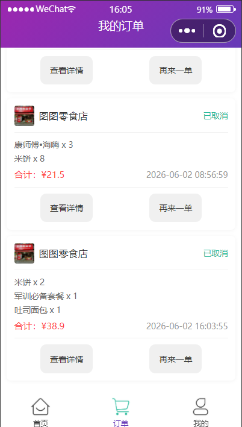

### **订单页**

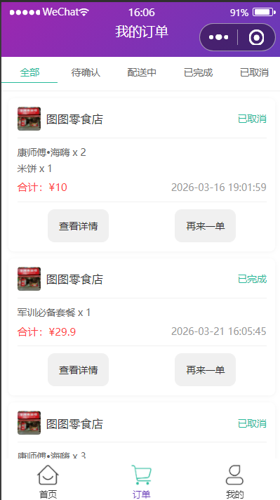

### **订单详情页**


### **我的页**

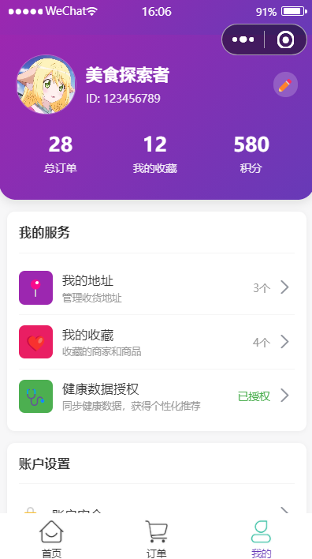

**我的收藏**

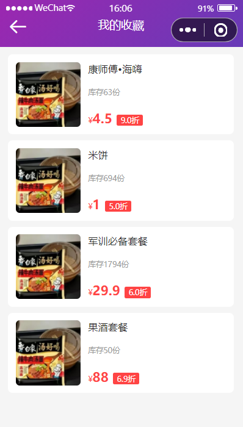

**AI页**

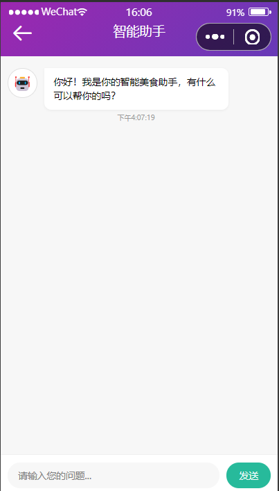

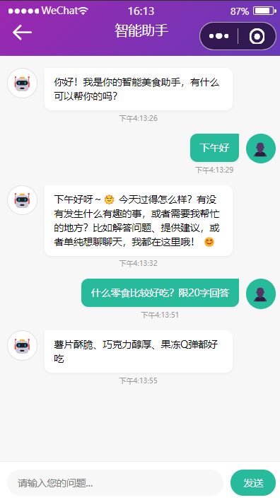

**关于我们**

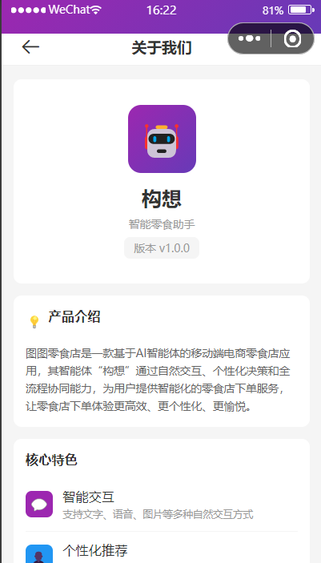

**意见反馈**

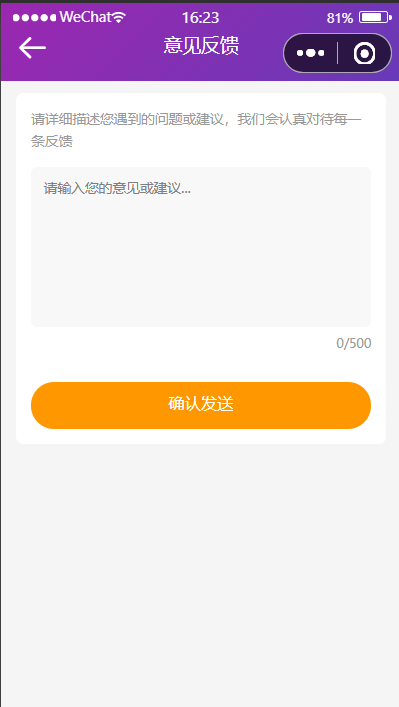

### **设置页**

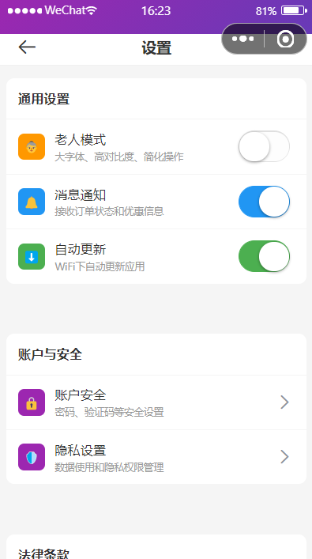

## 🔧 快速开始

### 环境要求

- Node.js >= 16.x
- 微信开发者工具（用于小程序端预览）
- Java 8+ 与 MySQL 8.0+（用于后端服务）

### 安装依赖

```bash
# 使用 npm
npm install

# 或使用 pnpm
pnpm install
```

### 运行开发服务（运行前记得修改manifest.json里的appid为自己的）

```bash
# H5 浏览器端
npm run dev:h5

# 微信小程序端
npm run dev:mp-weixin
```

### 微信小程序预览

运行 `npm run dev:mp-weixin` 后，使用微信开发者工具导入 `dist/dev/mp-weixin` 目录即可预览（建议用HBuilder X一键打包运行微信小程序）。

### 启动后端服务

后端服务基于 Java + MySQL + MyBatis 搭建，需确保：

1. **数据库准备**: 创建 MySQL 数据库，导入数据表结构
2. **配置修改**: 修改后端数据库连接配置
3. **启动服务**: 运行 Java 后端服务，默认端口 `8080`
4. **千帆 AI 服务**: 配置百度千帆 Qianfan API Key，启用 ERNIE-3.5-8K 模型

## 🤖 智能体「构想」能力说明

智能体「构想」是图图零食店的核心 AI 能力，集成于应用的多个场景：

| 场景 | 能力说明 | 技术实现 |
|------|----------|----------|
| AI 助手对话 | 用户可通过自然语言咨询商品、下单建议 | Qianfan ERNIE-3.5-8K 对话接口 |
| 个性化推荐 | 分析用户偏好，智能推荐零食商品 | 用户画像 + 大模型推荐算法 |
| 智能搜索 | 支持语义化搜索，理解用户模糊需求 | 向量检索 + 自然语言理解 |


## 📄 License

图图零食店 - 基于 AI 智能体的移动端电商零食店应用
