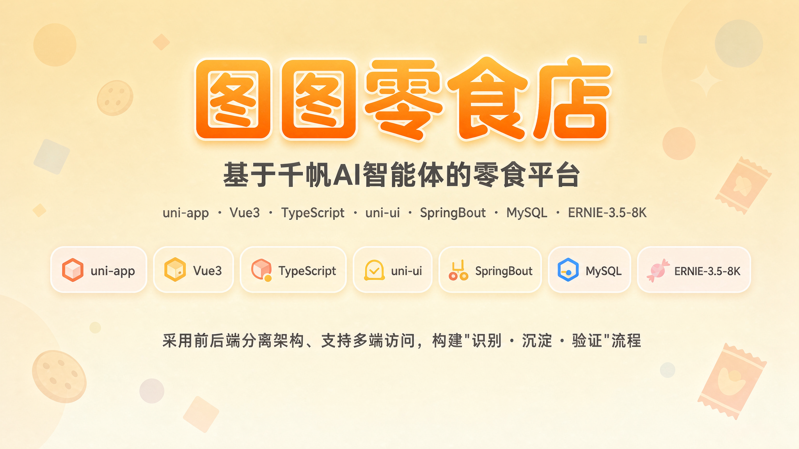
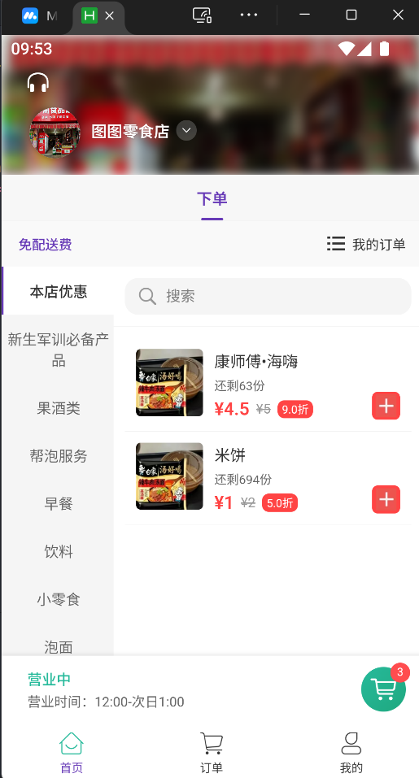
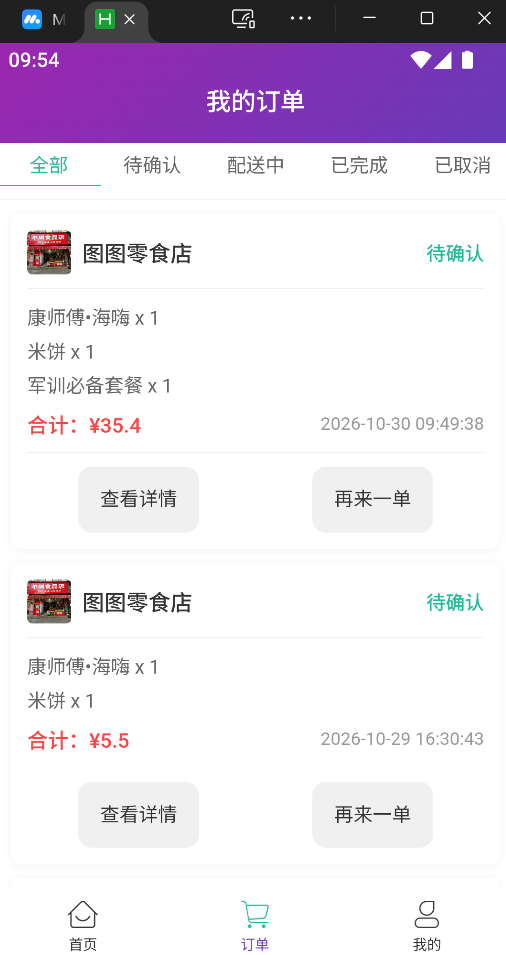
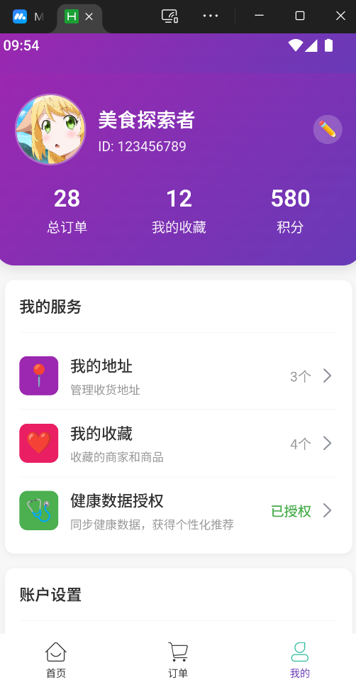
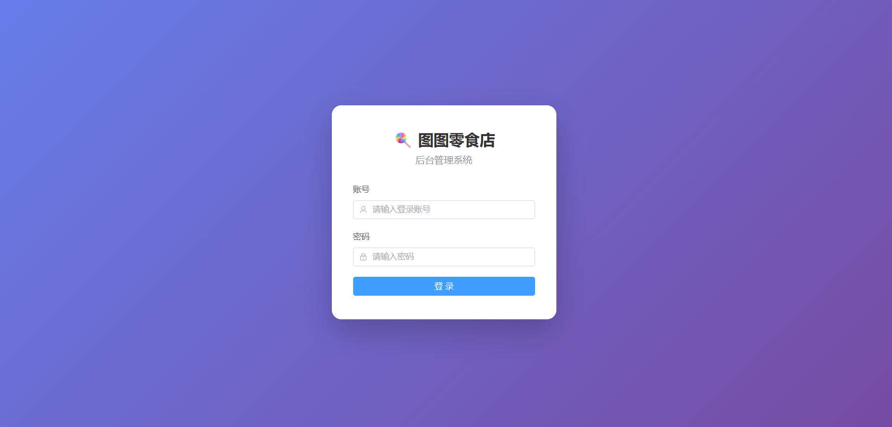
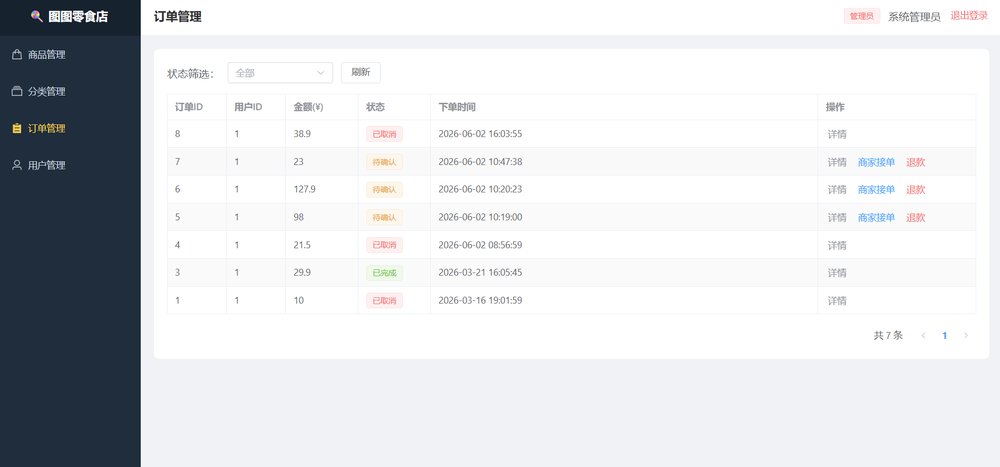
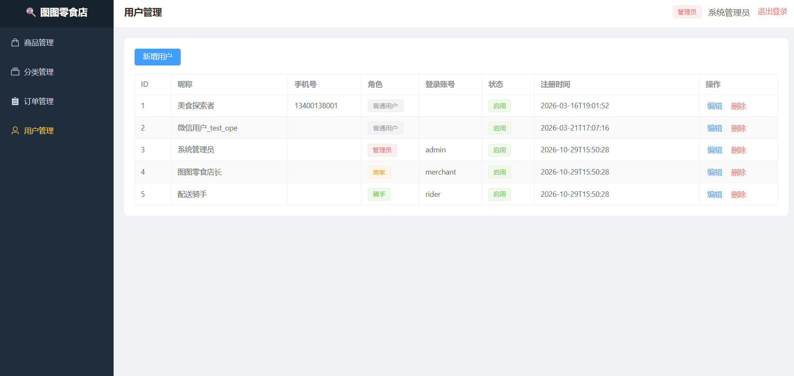
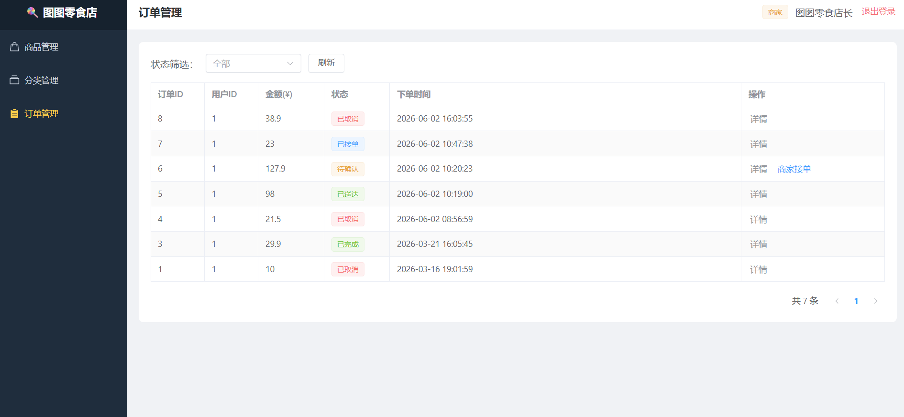
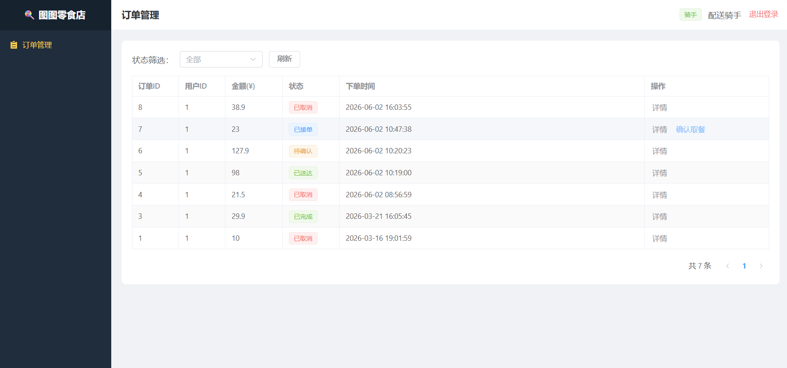

# 图图零食店

<p align="center">
  
  
  
  
  
  
  
  
  
  
  
  
  
  
</p>

一款基于 AI 智能体的移动端电商零食店应用，为用户提供智能化的零食购物体验。

## ✨ 项目简介

图图零食店是一款基于 **AI 智能体「构想」** 的移动端电商零食店应用，包含 **后台管理端、前台微信小程序端和 Android App 端**。智能体「构想」通过自然交互、个性化决策和全流程协同能力，为用户提供智能化的零食店下单服务，让零食店购物体验更高效、更个性化、更愉悦。

项目通过 **角色权限** 打通 C 端与 B 端：普通用户在小程序 / App 下单，商家、骑手、管理员在后台管理端协同处理订单，形成"下单 → 商家接单 → 骑手取餐 → 配送中 → 已送达"的完整闭环。

## 🛠 技术栈

### 前台小程序 / APP 端

- **框架**: [uni-app](https://uniapp.dcloud.net.cn/)（Vue 3 + TypeScript）
- **状态管理**: [Pinia](https://pinia.vuejs.org/zh/)
- **组件库**: [uni-ui](https://uniapp.dcloud.net.cn/component/uniui/uni-ui.html)
- **构建工具**: Vite
- **多端发布**: 微信小程序、Android App

### 后台管理端（admin）

- **框架**: Vue 3 + TypeScript
- **UI 组件库**: [Element Plus](https://element-plus.org/zh-CN/)
- **路由**: Vue Router（登录守卫 + 角色路由）
- **请求**: Axios（统一拦截、`authentication` 请求头携带 JWT）
- **构建工具**: Vite（开发端口 `5174`）

### 后端

- **语言 / 框架**: Java 17 + Spring Boot 3.5.11
- **数据库**: MySQL 8
- **ORM 框架**: MyBatis
- **鉴权**: JWT（jjwt）
- **接口文档**: Knife4j（OpenAPI）
- **AI 大模型**: 百度千帆 Qianfan ERNIE-3.5-8K（智能体「构想」核心引擎）

## 🚀 核心功能

### 🤖 AI 智能体「构想」

- **智能对话**: 基于百度千帆 ERNIE-3.5-8K 大模型，用户可通过自然语言与智能体交互
- **个性化推荐**: 智能体根据用户偏好和历史行为，为用户推荐合适的零食商品
- **智能购物助手**: 帮助用户查询商品、加入购物车、确认订单等全流程服务

### 🛒 商品浏览与购物

- **商品列表**: 浏览零食店的各类商品，支持分类浏览
- **商品详情**: 查看商品图片、价格、库存等详细信息
- **购物车**: 添加商品到购物车，支持数量增减、删除、清空
- **商品搜索**: 快速搜索所需商品
- **个性化推荐**: AI 智能推荐符合用户口味的零食商品

### 📋 订单管理

- **下单结算**: 确认商品信息、提交订单
- **订单列表**: 查看全部订单，支持按状态筛选（全部/待确认/配送中/已完成/已取消）
- **订单详情**: 查看订单完整信息，包括商品、金额、配送状态
- **配送进度**: 可视化展示订单从"商家接单"到"已送达"的完整流程
- **催单功能**: 一键催单，实时提示
- **退款申请**: 支持订单退款申请
- **再来一单**: 快速复购历史订单

### 👤 用户中心

- **登录注册**: 支持账号密码登录和注册新账号
- **个人信息**: 展示用户头像、昵称等基本信息
- **我的收藏**: 展示收藏的商品
- **订单统计**: 显示总订单数、收藏数、积分
- **地址管理**: 管理收货地址
- **退出登录**: 安全退出账号

### ⚙️ 系统设置

- **通用设置**: 老人模式、消息通知、自动更新等开关
- **账户与安全**: 密码、验证码等安全设置
- **法律条款**: 隐私政策、用户协议
- **意见反馈**: 向开发者提交反馈和建议
- **关于我们**: 查看版本信息和公司介绍

### 🖥 后台管理端

后台管理端通过角色登录区分权限，商家、骑手直接在后台完成各自的业务操作。

- **商品管理**: 商品名称、售价、原价、库存、图片、所属分类、折扣的增删改查
- **分类管理**: 商品分类的新增、修改、删除
- **订单管理**:
  - 订单分页查询、按状态筛选、查看订单商品明细
  - 订单状态流转（按角色展示不同操作按钮）
  - 管理员可对「待确认」订单执行退款
- **用户管理**: 管理员、商家、骑手、普通用户四类账号的查询、新增、编辑、禁用、删除

## 👥 角色与权限

| 角色 | 登录入口 | 可用功能 |
|------|----------|----------|
| `admin` 管理员 | 后台管理端 | 商品、分类、订单（含退款）、用户管理全部权限 |
| `merchant` 商家 | 后台管理端 | 商品管理、分类管理、订单管理（**确认接单**） |
| `rider` 骑手 | 后台管理端 | 订单管理（**确认取餐 → 开始配送 → 确认送达**） |
| `customer` 普通用户 | 微信小程序 / App | 浏览商品、购物车、下单、订单查询、退款申请、AI 助手 |

> 后台菜单与订单操作按钮均按登录角色动态渲染；真正的状态校验在后端完成，避免越权操作。

## 🔄 订单状态流转

```text
                         ┌──────────── 管理员退款 ────────────┐
                         │                                  ▼
待确认 ──── 商家接单 ───▶ 已接单 ── 骑手取餐 ──▶ 已取餐 ── 骑手配送 ──▶ 配送中 ── 骑手送达 ──▶ 已送达
   │
   └──── 用户取消 / 管理员取消 ───▶ 已取消

待确认 ── 管理员退款 ──▶ 已退款
```

| 当前状态 | 目标状态 | 允许操作角色 | 接口 |
|----------|----------|--------------|------|
| 待确认 | 已接单 | 商家 / 管理员 | `PUT /order/admin/flowStatus` |
| 待确认 | 已退款 | 管理员 | `PUT /order/admin/flowStatus` |
| 已接单 | 已取餐 | 骑手 / 管理员 | `PUT /order/admin/flowStatus` |
| 已取餐 | 配送中 | 骑手 / 管理员 | `PUT /order/admin/flowStatus` |
| 配送中 | 已送达 | 骑手 / 管理员 | `PUT /order/admin/flowStatus` |
| 待确认 | 已取消 | 用户（小程序退款） / 管理员 | `PUT /order/updateStatus` |

状态机在 `OrderServiceImpl#adminFlowStatus` 中实现：先校验"当前状态 → 目标状态"是否合法，再校验操作角色是否有权限，两者都通过才更新数据库。

## 📁 项目结构

```text
├── tutu-snack-shop-git                     # 源代码目录
│   ├── tutu-snack-shop-backend             # 后端文件夹
│   │   └── lspevent                        # Spring Boot 工程（端口 8080）
│   │       ├── db_admin_upgrade.sql        # 后台角色 / 账号升级脚本（需执行）
│   │       └── tutu-snack-shop.sql         # 总数据库执行脚本
│   ├── tutu-snack-shop-fronted             # 前端文件夹（小程序 + App）
│   │   ├── admin                           # 后台管理端（Vue3 + Element Plus）
│   │   │   └── src/views                   # 商品 / 分类 / 订单 / 用户 / 登录页
│   │   └── src                             # 小程序 / App 源码
│   │       ├── pages                       # 首页、订单、我的等页面
│   │       └── utils/baseUrl.ts            # 后端地址统一配置（按端切换）
│   ├── tutu-snack-shop-fronted-UI          # 页面截图
│   └── README.md                           # 项目简介
```

## 📱 页面图片

### 前台小程序端

#### 首页


**添加购物车**


**结算**


**生成对应订单**


**再次购买**


**退款**


#### 订单页


#### 订单详情页


#### 我的页


**我的收藏**


**AI 页**


**关于我们**


**意见反馈**


#### 设置页


### App 端

#### 首页



#### 订单页



#### 我的页



### 后台管理端

#### 登录页



#### 订单管理页



#### 用户管理页



#### 商家页（商家账号登录：确认接单）



#### 骑手页（骑手账号登录：取餐 / 配送 / 送达）



## 🔧 快速开始

### 环境要求

- Node.js >= 18.x
- 微信开发者工具（用于小程序端预览）
- HBuilderX 4.x（用于 App 端运行 / 打包）
- Android 手机 或 MuMu 模拟器 （用于 App 端预览）
- JDK 17、Maven 3.8+、MySQL 8.0+（用于后端服务）

### 1. 初始化数据库

1. 创建 MySQL 数据库并导入项目自带的数据表结构与初始数据；
2. **再执行后台管理升级脚本** `tutu-snack-shop-backend/lspevent/db_admin_upgrade.sql`：
   - 为 `user` 表新增 `role`（角色）、`username`（登录账号）、`password`（密码）、`status`（账号状态）字段；
   - 预置管理员 / 商家 / 骑手三个演示账号。

> 未执行该脚本时，后台登录会报"账号或密码错误"，商品 / 分类 / 订单的关联查询也可能因字段缺失而异常。

### 2. 启动后端服务

```bash
cd tutu-snack-shop-backend/lspevent
mvn spring-boot:run
```

- 默认端口 `8080`，接口文档可在 Knife4j 页面查看；
- 需在 `application.yml` 中配置正确的 MySQL 连接；
- 千帆 AI 服务需配置百度千帆 Qianfan API Key，启用 ERNIE-3.5-8K 模型；
- 后端已放行本地开发端口（微信开发者工具、后台管理端 `5174`）的跨域请求。

### 3. 前台微信小程序

```bash
cd tutu-snack-shop-fronted
npm install
npm run dev:mp-weixin
```

用微信开发者工具导入 `dist/dev/mp-weixin` 目录即可预览；推荐直接用 HBuilderX 打开工程并"运行到小程序模拟器"。

### 4. App 端（Android / MuMu 模拟器）

1. 用 HBuilderX 打开 `tutu-snack-shop-fronted`；
2. 在 `manifest.json` 中填写自己的 AppID；
3. 在Android 手机设置里，连续点击版本号以开启开发者模式并在搜索框中搜索开发者模式，接着开启 USB 调试和安装选项，再用数据线连接电脑即可 或者 直接打开MuMu 模拟器使用默认手机模拟器启动即可；
4. HBuilderX 选择「运行 → 运行到手机或模拟器 → 运行到 Android App 基座」（在此之前要先安装一个插件才可以运行）。

> App 端访问后端时的地址由 `src/utils/baseUrl.ts` 统一管理：MuMu 等安卓模拟器需通过 `10.0.2.2` 访问电脑主机，真机调试则改为电脑的局域网 IP（详见下方「服务地址配置」）。

### 5. 后台管理端

```bash
cd tutu-snack-shop-fronted/admin
npm install
npm run dev
```

浏览器打开 `http://localhost:5174`，使用下方演示账号登录。

### 演示账号

| 角色 | 账号 | 密码 | 说明 |
|------|------|------|------|
| 管理员 | `admin` | `admin123` | 商品、分类、订单（含退款）、用户全部权限 |
| 商家 | `merchant` | `merchant123` | 商品、分类、订单（确认接单） |
| 骑手 | `rider` | `rider123` | 订单（取餐、配送、送达） |

## 🌐 服务地址配置

前端所有后端地址收敛在 `tutu-snack-shop-fronted/src/utils/baseUrl.ts`，通过 uni-app 条件编译按运行端切换：

| 运行端 | 业务后端（8080） | 登录 / 注册模拟服务（8000） |
|--------|------------------|------------------------------|
| 微信小程序 / H5 | `http://localhost:8080` | `http://localhost:8000` |
| App（MuMu 等安卓模拟器） | `http://10.0.2.2:8080` | `http://10.0.2.2:8000` |
| App（真机调试） | `http://<电脑局域网IP>:8080` | `http://<电脑局域网IP>:8000` |

```ts
let HOST = 'localhost'
// #ifdef APP-PLUS
HOST = '10.0.2.2'   // 安卓模拟器访问电脑主机；真机改为电脑局域网 IP
// #endif
export const baseUrl = `http://${HOST}:8080`
export const mockBaseUrl = `http://${HOST}:8000`
```

后台管理端的请求地址在 `tutu-snack-shop-fronted/admin/src/utils/request.ts` 中统一配置为 `http://localhost:8080`。

## 🔌 主要接口

| 方法 | 路径 | 说明 |
|------|------|------|
| POST | `/admin/login` | 后台登录，返回 JWT 与角色（`admin` / `merchant` / `rider`） |
| GET | `/category/list` | 分类列表 |
| POST / PUT / DELETE | `/category/insert`、`/category/update`、`/category/delete/{id}` | 分类增删改 |
| GET | `/product/list` | 商品列表 |
| POST / PUT / DELETE | `/product/insert`、`/product/update`、`/product/delete/{id}` | 商品增删改 |
| GET | `/order/list` | 订单分页查询，支持 `status` 状态过滤 |
| GET | `/orderItem/listByOrderId/{orderId}` | 订单商品明细 |
| PUT | `/order/admin/flowStatus?id=&status=&role=` | 后台订单状态流转（状态机 + 角色校验） |
| PUT | `/order/updateStatus?id=&status=` | 小程序端更新订单状态（退款 / 取消） |
| GET | `/user/list` | 用户列表 |
| POST / PUT / DELETE | `/user/insert`、`/user/update`、`/user/delete/{id}` | 用户（含员工账号）增删改 |
| POST | `/qianfan/chat` | AI 智能体「构想」对话 |

统一返回结构：

```json
{ "code": 1, "message": "成功", "data": {} }
```

`code = 1` 表示成功，`code = 0` 表示失败，失败时 `message` 返回具体原因。

## ❓ 常见问题

**1. App 端提示 `Failed to connect to localhost/127.0.0.1:8080`**

模拟器 / 手机里的 `localhost` 指向设备自身，不是电脑。安卓模拟器通过 `10.0.2.2` 访问电脑主机，真机则使用电脑局域网 IP，修改 `src/utils/baseUrl.ts` 后重新运行即可。

**2. App 端商品图标不显示**

不要使用 HTML 标签 ``（微信小程序编译时会自动转成 `<image>`，App 端不会），统一使用 uni-app 组件：

```vue
<image src="/static/images/1.png" mode="aspectFit"></image>
```

**3. 进入结算页报 `Cannot read property 'cartData' of undefined`**

App 端 `getCurrentPages()` 返回的页面对象没有 `options` 属性，页面参数应通过 `onLoad` 获取：

```ts
onLoad((options) => {
  loadCartData(options?.cartData as string)
})
```

**4. 后台管理端登录报 404 或跨域错误**

- 确认运行的是最新后端代码（包含 `AdminController`、放行 `5174` 的 `CorsConfig`）；
- 修改后需**重启**后端服务；
- 若 IDEA 中运行的后端指向其他代码目录，请改为当前仓库内的 `tutu-snack-shop-backend/lspevent`。

**5. 后台登录提示账号或密码错误**

确认已执行 `db_admin_upgrade.sql`，且 `user` 表中存在 `admin` / `merchant` / `rider` 账号，`status` 为 `active`。

**6. 微信开发者工具报 `tabBar iconPath 未找到`**

通常是开发者工具基础库版本号问题，使用旧版本2.xx.x即可；若仍报错，清除开发者工具缓存后重试。

## 📄 License

图图零食店 - 基于 AI 智能体的移动端电商零食店应用
